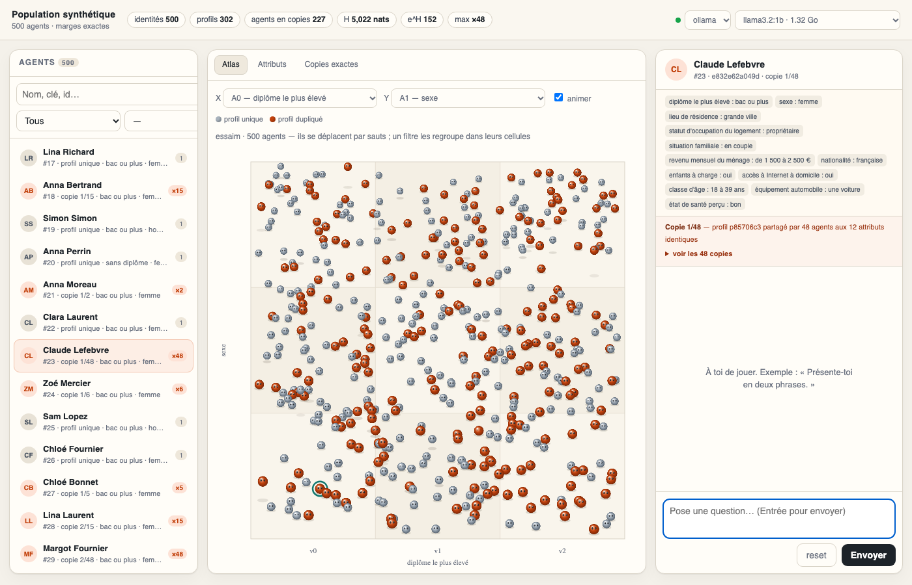

# Agents — identités uniques, GUI et conversation

Ce README couvre la partie **agents** du projet, ajoutée sur la branche
`feature/agents` (worktree `Synthetic-Population-agents`). Elle s'appuie sur la
population synthétique du repo principal sans modifier le générateur Java ni les
tables de marges.

Le repo principal produit 500 individus qui respectent exactement 45 tables de
marges. Cette couche ajoute ce qui manque pour en faire des agents manipulables :

- une **identité unique** par agent, dérivée des attributs ;
- une **GUI locale** pour voir la population et discuter ;
- une **CLI de conversation** ;
- un **benchmark** de modèles légers.

---

## 1. Pourquoi ajouter des attributs

`population.csv` contient 500 lignes mais seulement **302 personas distinctes** :
les marges imposent au moins 169 copies en trop. Impossible donc de rendre les
500 agents uniques avec les seuls `A0..A11`.

La solution ajoute deux attributs **hors tables** :

| Attribut | Rôle |
|---|---|
| `prenom` | partie lisible de l'identité |
| `nom` | idem |
| `identity_key` | SHA-256 tronqué de **tous** les attributs |

Les tables ne couvrent pas `prenom`/`nom` : **aucune marge ne change**. Les noms
sont tirés sans remise, donc les 500 vecteurs d'attributs sont distincts et
`identity_key` n'a aucune collision.

Garanties vérifiées par les tests :

- erreur L1 sur les 45 tables = **0** après enrichissement ;
- 500 `identity_key` distinctes ;
- 500 vecteurs d'attributs distincts.

### Identités vs profils : les copies exactes sont conservées

Les prénoms rendent les **identités** uniques, pas les **profils**. Sur les 12
attributs contraints il n'existe que **302 profils** : 198 agents sont donc des
copies exactes d'un autre agent et répondront de façon quasi identique à modèle
et température égaux. Ces copies ne sont ni supprimées ni déguisées, elles sont
exposées :

| Champ (`agents.jsonl` / `agents.csv`) | Sens |
|---|---|
| `cluster_id` | identifiant du profil (`p` + hash des 12 attributs), partagé par toutes ses copies |
| `copy_index` | rang de l'agent dans son cluster (1..N) |
| `copies` | nombre d'agents qui portent exactement ce profil |

Dans la GUI, le badge `×N` de la liste, la bannière sous l'en-tête du chat et
l'onglet **Copies exactes** montrent le cluster et permettent de passer d'une
copie à l'autre. `manifest.json` ajoute `distinct_profiles` (302),
`duplicated_agents` (227 agents partagent leur profil), `exact_copies`
(198 lignes redondantes) et `max_copies` (48).

---

## 2. Démarrage rapide

```bash
# 1. construire les agents (déterministe, seed 0)
uv run python tools/build_agents.py constraint_cells.csv population.csv

# 2. GUI
uv run python tools/gui.py --open
#    http://127.0.0.1:8765

# 3. conversation en terminal
uv run python tools/chat_agent.py --agent 42 --provider ollama --model llama3.2:1b

# 4. sonder la population (démo hors ligne sur 8 agents)
uv run python tools/survey.py surveys/demo.fr.json --provider mock --limit 8 --seed 0

# 5. tests
uv run python -m unittest discover -s tests -v
```

### Vue d'ensemble

```
constraint_cells.csv ─┐
population.csv ───────┴─► build_agents.py ─► agents/
                                             ├─ agents.csv / agents.jsonl   (500 agents)
                                             ├─ labels.json                 (libellés pour la GUI)
                                             └─ manifest.json               (contrôles + provenance)
                                                    │
                    ┌───────────────────────────────┼───────────────────────────────┐
                    ▼                               ▼                               ▼
              gui.py --open                  chat_agent.py                    survey.py
        (voir, filtrer, atlas, chat,      (conversation CLI, REPL,      (questionnaire -> agrégats,
         onglet Sonder)                    flux en direct)               tableaux croisés)
                    └───────────────────────────────┬───────────────────────────────┘
                                                    ▼
                            eval_fidelity.py  (mesure le respect des profils)
                                                    │
                                                    ▼
                     fournisseur : mock (hors ligne) | openai | ollama
```

En clair : le générateur Java (repo principal) produit une population exacte ;
`build_agents.py` en fait des agents identifiables ; les quatre outils Python
(GUI, CLI, sonde, fidélité) les exploitent via un fournisseur de modèle.

### Prérequis et environnements

Aucune dépendance Python n'est nécessaire pour `build_agents.py`, `gui.py`,
`chat_agent.py`, `survey.py` et `eval_fidelity.py` : **bibliothèque standard
uniquement**. Python **3.12** est recommandé (c'est ce que `pyproject.toml`
exige) ; le code n'utilisant que la stdlib, il tourne aussi sur des versions plus
anciennes. Les dépendances (ortools, pandas, numpy, playwright) ne concernent que
les outils de référence et les tests navigateur.

**uv (recommandé)**

```bash
uv run python tools/gui.py --open        # uv lit pyproject.toml, crée .venv tout seul
```

**Python + venv + pip (sans uv)**

```bash
python3.12 -m venv .venv
source .venv/bin/activate            # Windows PowerShell : .venv\Scripts\Activate.ps1
python tools/gui.py --open           # rien à installer (stdlib)
# optionnel : pip install ortools pandas numpy    (tools/reference_*.py)
```

**conda / mamba**

```bash
conda create -n synthpop python=3.12 -y
conda activate synthpop
python tools/gui.py --open           # rien à installer (stdlib)
# optionnel : conda install -c conda-forge ortools pandas numpy
```

Lance les commandes **depuis la racine du dépôt** (les chemins `agents/`,
`surveys/`, `constraint_cells.csv` sont relatifs). Sinon, indique-les
explicitement : `--agents chemin/agents.jsonl`, `--surveys chemin/surveys`, et
donne le chemin des CSV à `build_agents.py`.

Ollama est optionnel ; sans lui, le fournisseur `mock` permet de tester le
câblage (il ne « réfléchit » pas, il valide le pipeline).

---

## 3. Fichiers

```
tools/
  build_agents.py            # population -> agents identifiables
  chat_agent.py              # CLI de conversation (mock / OpenAI / Ollama)
  survey.py                  # sonde : poser un questionnaire à tout/partie des agents
  eval_fidelity.py           # mesure le respect des profils (une question par attribut)
  fidelity_probes.fr.json    # questions et motifs acceptés pour eval_fidelity
  gui.py                     # serveur local + interface web (stdlib)
  bench_models.py            # latence, tokens/s, VRAM des modèles Ollama
  agent_labels.fr.json       # libellés réels des 12 attributs
surveys/
  demo.fr.json               # questionnaire d'exemple (5 questions)
agents/
  agents.csv                 # id, stable_id, identity_key, cluster_id, copy_index, copies, prenom, nom, A0..A11
  agents.jsonl               # un agent par ligne + prompt système
  labels.json                # copie des libellés utilisée par la GUI
  manifest.json              # contrôles (unicité, marges, seed)
tests/
  test_agents.py             # pipeline, marges, unicité, prompt
  test_gui.py                # API HTTP de la GUI
  test_survey.py             # sélection, sonde mock, reprise, agrégation
  test_eval_fidelity.py      # appariement, harnais mock, CLI
docs/
  gui.png                    # aperçu
```

### Format `agents.jsonl`

```json
{
  "id": 1,
  "stable_id": "d41275b8-6cb6-501b-a39e-c22f8afd4792",
  "prenom": "Zoé",
  "nom": "François",
  "identity_key": "72da82b12be8",
  "cluster_id": "p3f0c1a9d2",
  "copy_index": 1,
  "copies": 3,
  "attributes": {"A0": "v1", "...": "...", "prenom": "Zoé", "nom": "François"},
  "persona": "Tu es Zoé François.\nTu participes à une discussion..."
}
```

`persona` est le prompt système envoyé au modèle. L'identité (`identity_key`) est
une métadonnée : elle n'est **pas** dans le prompt, pour éviter que les petits
modèles s'y accrochent et sortent du personnage.

`stable_id` est un **UUIDv5** dérivé de `identity_key` : une clé standard, opaque
et sans collision, utilisable comme identifiant externe (base de données, suivi
d'un agent). Il ne dépend que des attributs, donc il change lui aussi si la
population est régénérée ; `id` (numéro de ligne) n'est qu'un rang de lecture.

---

## 4. GUI

```bash
uv run python tools/gui.py                 # 127.0.0.1:8765
uv run python tools/gui.py --open          # ouvre le navigateur
uv run python tools/gui.py --port 9000 --agents agents/agents.jsonl
uv run python tools/gui.py --port 0        # port libre choisi par l'OS
```

Si le port demandé est occupé, le serveur essaie automatiquement les 10 suivants
et affiche celui qu'il utilise.



| Zone | Contenu |
|---|---|
| **Agents** | 500 lignes, recherche nom/clé/id, filtre `attribut = valeur` |
| **Atlas** | essaim animé : chaque agent est une bille 3D avec de petits yeux clignotants, immobile la plupart du temps, qui saute de temps en temps vers un point aléatoire ; orange = profil dupliqué ; un filtre regroupe les agents dans leurs cellules X/Y ; clic = sélection |
| **Attributs** | distribution des 12 marges, avec les comptes exacts |
| **Copies exactes** | profils partagés ×2 à ×N, membres du cluster cliquables |
| **Sonder** | lance un questionnaire sur tout/partie des agents avec le modèle courant, suit la progression et affiche les résultats agrégés (barres + tableaux croisés) |
| **Chat** | historique, latence, choix fournisseur/modèle |

La GUI écoute sur `127.0.0.1` par défaut, **sans authentification**. Ne l'expose
pas sur un réseau public : elle peut appeler ton fournisseur LLM avec ta clé.

L'**Atlas** est un essaim : chaque point est une bille 3D avec de petits yeux qui
clignotent. La bille reste **immobile la plupart du temps** et, de temps en temps,
fait un petit **saut** (trajectoire balistique avec ombre au sol) vers un point
voisin, donc l'essaim est dispersé partout par défaut. Dès qu'un filtre
(recherche ou `attribut = valeur`) est actif, les agents correspondants rejoignent
leur cellule `X × Y` et les autres s'estompent — y compris quand l'animation est
en pause. `animer` met le mouvement en pause ; `prefers-reduced-motion` désactive
l'animation au chargement. La position dans la grille n'est donc **pas** une
projection des 12 attributs : seuls X et Y comptent pour le regroupement, le
profil complet reste dans le panneau de droite.

Le sélecteur de modèle liste les modèles Ollama installés avec leur taille ; les
modèles d'embedding sont masqués.

---

## 5. Conversation

```bash
# un tour, non interactif
uv run python tools/chat_agent.py --agent 42 --message "Tu fais quoi dans la vie ?"

# REPL
uv run python tools/chat_agent.py --agent 42
```

Commandes du REPL : `/who`, `/attrs`, `/agent <id|clé|nom>`, `/reset`, `/quit`.
L'agent peut être désigné par son id, sa clé d'identité ou son nom.

### Fiabilité et flux

- **Flux en direct** : le REPL et la GUI affichent la réponse **jeton par jeton**
  (Ollama et OpenAI en streaming ; `--no-stream` pour désactiver en CLI).
- **Nouvelle tentative automatique** : les erreurs réseau et les codes `429`,
  `500`, `502`, `503`, `504` sont réessayés avec un délai exponentiel (2 essais) ;
  un `404` Ollama (« modèle introuvable ») échoue tout de suite, sans réessai.
- **Budget de contexte** : l'historique est coupé par **taille estimée**
  (`--budget-tokens`, défaut 3000), pas par nombre de messages, pour ne pas
  dépasser la fenêtre ni tronquer la persona.
- **Contrôles** : `--temperature`, `--max-tokens`, `--seed` (rend aussi
  reproductible la sélection `--agent random`).

### Fournisseurs

| `--provider` | Prérequis | Variables |
|---|---|---|
| `mock` (défaut) | aucun, hors ligne | — |
| `openai` | clé API | `OPENAI_API_KEY`, `OPENAI_BASE_URL`, `OPENAI_MODEL` |
| `ollama` | `ollama serve` | `OLLAMA_HOST`, `OLLAMA_MODEL`, `OLLAMA_THINK`, `OLLAMA_NUM_CTX` |

```bash
OPENAI_API_KEY=sk-... uv run python tools/chat_agent.py --agent 42 --provider openai
uv run python tools/chat_agent.py --agent 42 --provider ollama --model llama3.2:1b
```

`mock` ne simule pas une conversation : il vérifie le pipeline sans réseau.
`OLLAMA_THINK=0` (défaut pour qwen3/deepseek-r1) coupe la réflexion, qui consomme
le budget de tokens avant la réponse. `OLLAMA_NUM_CTX` (défaut 4096) fixe la
fenêtre de contexte : trop petite, elle tronque la persona dès que l'historique
grandit (échec silencieux).

**Cohérence de la persona.** Le prompt système exige de répondre avec
**exactement** la valeur du profil pour toute information qu'il contient (âge,
logement, revenu…). Avec un petit modèle, la fidélité n'est pas garantie : vérifie
sur un échantillon. Deux agents qui partagent un `cluster_id` (copies exactes)
donnent des réponses quasi identiques à modèle et température égaux.

La conversation est **isolée par agent** : changer d'agent dans la GUI (ou
`/agent` en CLI) repart d'un historique vide, et l'en-tête du chat affiche le
`cluster_id` de l'agent courant.

---

## 6. Sonder la population (survey)

`tools/survey.py` pose **le même questionnaire à tout ou partie des agents** et
agrège les réponses. C'est l'outil qui transforme la population en instrument :
on ne discute plus avec un agent, on interroge un échantillon.

Le questionnaire est un JSON :

```json
{
  "title": "Baromètre 2026",
  "questions": [
    {"id": "climat", "text": "Le changement climatique est-il une priorité ?",
     "choices": ["oui", "non", "ne se prononce pas"]},
    {"id": "plus_important", "text": "Quelle mesure améliorerait votre quotidien ?"}
  ]
}
```

Une question avec `choices` est fermée (le choix est reconnu dans la réponse,
accents/casse/ponctuation ignorés) ; sans `choices`, la réponse est libre.

### Sélection : tout, ou une partie

| Option | Effet |
|---|---|
| *(aucune)* | les 500 agents |
| `--one-per-cluster` | un seul agent par profil contraint (302, évite de sur-pondérer les copies exactes) |
| `--where A1=v2` | agents vérifiant `attribut=valeur` (répétable, ou `--where A1=v2,A9=v1`) |
| `--ids 1,5,23` | identifiants explicites |
| `--limit 50 --seed 0` | échantillon aléatoire reproductible |

### Exécution

```bash
# démonstration hors ligne (aucun réseau), 8 agents
uv run python tools/survey.py surveys/demo.fr.json --provider mock --limit 8 --seed 0

# vraie sonde locale sur les 302 profils distincts
uv run python tools/survey.py surveys/demo.fr.json --one-per-cluster \
    --provider ollama --model llama3.2:1b --concurrency 2

# sous-population + tableau croisé par sexe et classe d'âge
uv run python tools/survey.py surveys/demo.fr.json --where A1=v2 --crosstab A1,A9
```

- **Concurrence bornée** (`--concurrency`, 1–4 conseillé pour Ollama, qui met le
  reste en file).
- **Reprise** : les réponses sont écrites au fil de l'eau dans
  `surveys/<nom>.answers.jsonl`. Relancer la même commande **saute** les couples
  (agent, question) déjà faits — utile si un run est interrompu. `--force` repart
  de zéro.
- `--shuffle` tire l'ordre des questions par agent (détecter un effet d'ordre).
- Le fournisseur `mock` répond de façon **déterministe** (hachage de
  `identity_key` + question) : il valide tout le pipeline sans modèle.

### La sonde depuis la GUI

L'onglet **Sonder** fait la même chose sans ligne de commande : il utilise le
questionnaire choisi, la portée (tous / un par profil / filtre courant /
échantillon), le fournisseur et le modèle du bandeau. La sonde tourne en
arrière-plan (barre de progression) et les résultats s'affichent en barres avec
le tableau croisé demandé. Chaque lancement est **frais** et écrit un fichier
`surveys/<nom>.<provider>.<model>.answers.jsonl`, pour ne jamais mélanger deux
modèles dans un même fichier.

> **Copies exactes** : en portée « tous », les agents qui partagent un profil
> (×2 à ×48) répondent de façon identique. Utilise « un par profil » (302) pour
> ne pas sur-pondérer un même profil.

### Sortie

- `surveys/<nom>.answers.jsonl` : une ligne par `(agent, question)` avec l'agent,
  son `cluster_id`, la question, la réponse brute, le `choice` reconnu, le modèle
  et la latence.
- `surveys/<nom>.report.json` : par question, la répartition des choix, les
  proportions, les erreurs, et les tableaux croisés demandés. Le terminal affiche
  la même chose en barres.

Ces fichiers sont ignorés par git (`surveys/*.answers.jsonl`,
`surveys/*.report.json`).

---

## 7. Quel modèle pour 500 agents ?

**Un seul modèle suffit.** La persona est dans le prompt : une instance Ollama
sert les 500 agents. La mémoire consommée est celle du modèle + le cache de
contexte, pas 500 × le modèle. Pour du batch, rester à **1–4 requêtes
concurrentes** : Ollama met les autres en file.

Mesures sur cette machine (Apple M2, **8 Go**, 2 runs, 100 tokens) :

| Modèle | Taille | Latence | tok/s | VRAM | Verdict |
|---|---|---|---|---|---|
| `qwen3:0.6b` | 0,5 Go | 0,6–0,8 s | 117–135 | 1,0 Go | très rapide, casse souvent le personnage |
| **`llama3.2:1b`** | **1,3 Go** | **1,1–1,3 s** | **58–61** | **1,5 Go** | **défaut recommandé** |
| `llama3.2:3b` | 2,0 Go | 2,8 s | 37 | 2,6 Go | meilleure qualité, encore confortable |
| `qwen3-abliterated:4b` | 2,5 Go | 2,9 s | 28 | 3,2 Go | sans filtres, bon compromis |
| `llama3.2-abliterate:3b` | 2,2 Go | 2,9 s | 38 | 2,6 Go | sans filtres, plus rapide |
| `dolphin3:8b` | 4,9 Go | 154 s | 0,8 | 4,6 Go | swap sur 8 Go, à éviter |
| `qwen2.5:1.5b` | ~1,0 Go | — | — | ~1,2 Go | alternative au 1b |
| `gemma3:1b` | ~0,8 Go | — | — | ~1,0 Go | alternative compacte |
| `llama3.1:8b` | 4,9 Go | — | — | ~5,5 Go | trop juste avec navigateur + OS sur 8 Go |

```bash
ollama serve
ollama pull llama3.2:1b
ollama pull llama3.2:3b
uv run python tools/bench_models.py --models qwen3:0.6b,llama3.2:1b,llama3.2:3b
```

`bench_models.py --pull` télécharge les modèles manquants. Le script mesure la
latence médiane, les tokens/s et la VRAM sur une vraie persona du fichier
`agents/agents.jsonl`.

**Recommandation** : `llama3.2:1b` pour explorer la population, `llama3.2:3b`
quand la qualité de la persona compte. Le choix d'un modèle ne se fait plus
seulement sur la vitesse : `tools/eval_fidelity.py` mesure le **respect des
profils**.

### Fidélité mesurée aux attributs

`eval_fidelity.py` pose une question factuelle par attribut (12 par agent) et
vérifie que la réponse correspond au profil. Exemple :

```bash
uv run python tools/eval_fidelity.py --one-per-cluster \
    --models llama3.2:1b,qwen3:0.6b,huihui_ai/llama3.2-abliterate:3b
```

Sur 10 agents (120 questions, temperature 0, seed 0) :

| Modèle | Fidélité | Faiblesses |
|---|---|---|
| **`qwen3:0.6b`** | **98 %** | A2 (lieu), A10 (voitures) |
| `huihui_ai/llama3.2-abliterate:3b` | 95 % | A0 (diplôme), A11 (santé) |
| `llama3.2:1b` | 91 % | A2, A5 (revenu), A7, A10 |

Lecture : un petit modèle peut être **très fidèle aux attributs** (le 0.6B) même
s'il tient mal un personnage long, et inversement. Mesure sur un échantillon
(10 agents) : pour trancher, relance sur `--one-per-cluster` (302 agents). Les
sondes (`tools/fidelity_probes.fr.json`) reposent sur la même sémantique supposée
que les libellés ; adapte-les si tu connais les vrais attributs.

### Questions sans filtres

Les modèles « abliterated » réduisent fortement les refus sans changer la persona.
Mesuré sur cette machine :

| Modèle | Taille | Latence | tok/s | VRAM | Verdict |
|---|---|---|---|---|---|
| **`huihui_ai/qwen3-abliterated:4b`** | 2,5 Go | 2,9 s | 28 | 3,2 Go | **choix recommandé** : français correct, reste dans le personnage |
| `huihui_ai/llama3.2-abliterate:3b` | 2,2 Go | 2,9 s | 38 | 2,6 Go | plus rapide, mais français approximatif et tendance à théâtraliser |
| `dolphin3:8b` | 4,9 Go | 154 s | 0,8 | 4,6 Go | swappe sur 8 Go, inutilisable ici |

```bash
ollama pull huihui_ai/qwen3-abliterated:4b
uv run python tools/chat_agent.py --agent 3 --provider ollama \
    --model huihui_ai/qwen3-abliterated:4b
```

Testé sans refus sur des questions de vote, de religion, de cannabis et
d'immigration. Un modèle sans filtres n'est pas sans biais : il peut produire des
stéréotypes, des erreurs factuelles, et sortir du personnage. Valider un
échantillon avant d'exploiter les réponses.

---

## 8. Attributs réels

Les libellés d'origine de `A0..A11` **ne figurent pas dans le repo**. Pour rendre
les conversations possibles, `tools/agent_labels.fr.json` propose une
interprétation plausible et cohérente avec les distributions observées. Ce n'est
pas une vérité : si tu connais la vraie sémantique, édite ce fichier et relance
`build_agents.py`.

| Code | Attribut | Valeurs (effectifs) |
|---|---|---|
| A0 | diplôme le plus élevé | bac ou plus 461 · sans diplôme 28 · CAP/BEP 11 |
| A1 | sexe | femme 254 · homme 244 · autre 2 |
| A2 | lieu de résidence | grande ville 398 · commune rurale 94 · outre-mer 8 |
| A3 | statut du logement | propriétaire 347 · locataire 142 · logé gratuitement 11 |
| A4 | situation familiale | en couple 313 · célibataire 99 · divorcé/veuf 88 |
| A5 | revenu mensuel du ménage | 1 500–2 500 € 278 · < 1 500 € 177 · > 2 500 € 45 |
| A6 | nationalité | française 454 · autre UE 27 · hors UE 19 |
| A7 | enfants à charge | oui 352 · non 134 · non renseigné 14 |
| A8 | accès à Internet | oui 490 · non 10 · ne sait pas 0 |
| A9 | classe d'âge | 18–39 ans 251 · 40–59 ans 141 · 60+ 108 |
| A10 | équipement automobile | une voiture 448 · aucune 48 · deux ou plus 4 |
| A11 | état de santé perçu | bon 261 · très bon 169 · limité 70 |

Les libellés sont **appliqués par défaut** :

```bash
uv run python tools/build_agents.py constraint_cells.csv population.csv
# --no-labels pour revenir aux A0=v1 bruts
# --labels mon_fichier.json pour une autre interprétation
```

Ils servent à trois endroits :

- le **prompt système** (`"classe d'âge : 40 à 59 ans"`), donc les réponses ;
- la **GUI** (filtres, infobulles, tableau des marges) ;
- `agents/labels.json`, pour que la GUI n'ait pas à deviner.

Les prénoms sont aussi cohérents avec `A1` : Gabriel ne sera pas « femme ».
Sans `--labels`, les prénoms sont tirés dans un pool mixte.

Exemple de question réelle, avec `llama3.2:3b` :

> **Q.** Quel âge as-tu, où vis-tu, et combien gagnes-tu par mois ?
> **R.** J'ai 52 ans, je vis en grande ville, en France. Mes revenus mensuels sont
> un peu en dessous de 1 200 €, ça peut varier d'un mois à l'autre.

Le modèle s'appuie bien sur la classe d'âge et la tranche de revenu. `llama3.2:1b`
reste plus vague sur les chiffres.

---

## 9. Tests

```bash
uv run python -m unittest discover -s tests -v
```

55 tests couvrent :

- l'exactitude des marges après enrichissement ;
- l'unicité des identités, des `stable_id` et des vecteurs d'attributs ;
- le déterminisme (même seed → sortie identique) et le mode `--check` ;
- la complétude du prompt ;
- l'application des libellés réels et la cohérence prénom/sexe ;
- la sélection d'agent (id, clé, nom), le budget de contexte et les reprises sur erreur ;
- l'API de la GUI (liste, méta, chat, chat en flux, sondage, erreurs) ;
- la sélection et l'agrégation de la sonde, et l'appariement de fidélité ;
- le CLI `--list` et le chat one-shot en mode mock.

---

## 10. Ce que l'on peut faire (et ce que l'on ne peut pas)

### On peut

- construire **500 agents identifiables** dont les 12 attributs respectent
  **exactement** les 45 tables de marges (erreur L1 = 0) ;
- explorer la population (liste, filtres, atlas, distributions, copies exactes) ;
- **discuter** avec un agent (CLI ou GUI), conversation isolée par agent ;
- **sonder** tout ou partie de la population et agréger (choix, croisements) ;
- **mesurer** la fidélité d'un modèle au profil, et comparer des modèles ;
- choisir le fournisseur : `mock` (hors ligne), `openai`, `ollama` ;
- reproduire à l'identique (seed + entrées) et **vérifier** avec `--check`.

### On ne peut pas

- rendre les 500 agents **démographiquement distincts** : il n'existe que
  **302 profils** sur les 12 attributs ; 198 lignes sont des copies exactes qui
  répondront de façon identique (utiliser « un par profil » pour sonder).
- garantir la **fidélité** d'un petit modèle : elle se mesure, elle ne se suppose
  pas (voir §7).
- connaître la **vraie sémantique** de `A0..A11` : les libellés sont une
  interprétation plausible, pas une vérité ; la sonde et l'évaluation de fidélité
  en dépendent.
- obtenir un **échantillon statistique** d'une population réelle : la population
  est synthétique, ses marges viennent des tables fournies.
- empêcher un modèle de produire des **stéréotypes** ou des erreurs factuelles,
  ni de sortir du personnage sur des sujets sensibles (surtout les modèles
  « abliterated »).
- **exposer la GUI** sur un réseau : pas d'authentification, elle détient l'accès
  au fournisseur LLM. Elle écoute sur `127.0.0.1` par défaut.
- modifier le **générateur Java** ou les marges depuis cette couche : hors périmètre.

---

## 11. Voir aussi

- `README.md` (repo principal) : problème des marges, algorithme greedy,
  dé-clonage, résultats et optimum CP-SAT.
- Branche `feature/agents-toolkit` (worktree `Synthetic-Population-agents`) :
  cette couche agents. Elle part de `feature/agents`.

---

## 12. Reproductibilité et provenance

- **Sortie déterministe** : à seed et entrées égales, `build_agents.py` produit
  des fichiers **identiques octet à octet** (vérifié par un test).
- **`stable_id`** : UUIDv5 par agent, clé externe stable et sans collision.
- **Provenance** dans `agents/manifest.json` : `tool`, `tool_version`, `seed`,
  `git_commit`, et les empreintes SHA-256 des **entrées**
  (`constraints_sha256`, `population_sha256`, `labels_sha256`). On peut donc
  savoir exactement quelle population et quels libellés ont produit les agents.
- **Mode `--check`** : vérifie que `agents/` correspond aux entrées actuelles,
  sans rien écrire. À lancer en CI ou après une modification de `population.csv` :

```bash
uv run python tools/build_agents.py constraint_cells.csv population.csv --check
# agents est à jour (entrées inchangées, seed 0).
```

- **Environnement** : `pyproject.toml` fixe `requires-python >= 3.12` ; aucune
  dépendance pour la GUI, la CLI, la sonde et l'évaluation (stdlib seule).
- **CI** : `.github/workflows/tests.yml` lance le `--check` puis les tests.
